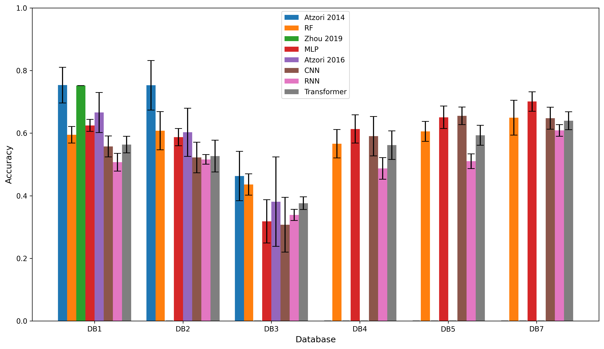

# EMG Gesture Classification with Machine Learning (NinaPro)

MEng Robotics Engineering final-year project (2025).

> The code is published as submitted in 2025. The only changes for publishing were unzipping it, adding this README, `requirements.txt` and `.gitignore`, and removing earlier draft files.

The project compares five machine-learning techniques for classifying hand gestures from surface electromyography (sEMG) signals: Random Forest, MLP, CNN, RNN (LSTM) and Transformer. The aim is to control prosthetic hands. All five are evaluated on six [NinaPro](https://ninapro.hevs.ch/) databases (DB1–5 and DB7) using the same testing framework.

## Key findings

- **The MLP had the highest average accuracy** across all databases. However, it was statistically similar to the other methods, and the MLP was the easiest to optimise.
- **The Transformer shows the most potential.** It matched the others despite being the least optimised and most complex model, and it consistently beat the RNN.
- **Random Forest did best on amputee subjects (DB3)**, which is the group a commercial prosthesis is for.
- **All five models are fast enough for real-time use.** Every neural network averaged under 0.5 ms to classify each 200 ms window, and the MLP was fastest at 0.04–0.14 ms.



### Average test accuracy (%) — mean ± standard deviation over 5 randomised tests

| Method      | DB1        | DB2        | DB3 (amputees) | DB4        | DB5        | DB7        |
|-------------|------------|------------|----------------|------------|------------|------------|
| Random Forest | 59.5 ± 2.7 | **60.8 ± 6.1** | **43.6 ± 3.4** | 56.6 ± 4.5 | 60.5 ± 3.2 | 64.9 ± 5.6 |
| MLP         | **62.5 ± 1.9** | 58.7 ± 2.8 | 31.8 ± 6.9 | **61.3 ± 4.5** | 65.1 ± 3.6 | **70.1 ± 3.1** |
| CNN         | 60.6 ± 1.5 | 56.0 ± 5.5 | 33.6 ± 3.8 | 58.1 ± 3.5 | **65.2 ± 2.7** | 67.7 ± 2.6 |
| RNN (LSTM)  | 50.7 ± 2.8 | 51.6 ± 1.6 | 33.9 ± 1.8 | 48.7 ± 3.5 | 51.0 ± 2.4 | 60.9 ± 1.9 |
| Transformer | 56.3 ± 2.7 | 52.7 ± 5.1 | 37.6 ± 2.0 | 56.2 ± 4.6 | 59.3 ± 3.2 | 63.9 ± 2.9 |

Each database has 40–51 gesture classes across all subjects, so chance level is roughly 2%. The models are trained to work for all subjects, not tuned to each individual.

## Method

1. **Data extraction:** the `.mat` files from each NinaPro database are loaded, and every movement repetition is cut out using the `restimulus` signal. Each database labels gestures differently, so the labels are converted to one consistent class list.
2. **Train/validation/test split by repetition:** this happens before windowing. Overlapping windows would otherwise leak data between the sets. The repetitions in each split are randomised for every test.
3. **Filtering:** a 50 Hz notch filter is applied to the databases where power-line noise hadn't already been removed. The signals are then RMS-rectified over 100 ms.
4. **Windowing:** signals are resampled to 200 Hz, then split into 200 ms windows with 50% overlap, giving windows of 40 samples × the number of electrodes.
5. **Preprocessing:** each electrode channel is standardised, fitted on the training set only. Classes are then subsampled so they all have the same number of windows.
6. **Models:**
   - Random Forest on time-domain features (MAV, RMS, LD, IEMG, ZC, WAMP)
   - MLP, CNN (temporal and spatial branches), LSTM and Transformer, all built in PyTorch
7. **Evaluation:** test accuracy, confusion matrices and prediction time per window, over 5 tests per database.

Extracting the raw data and windowing it run in parallel, and resampling runs on the GPU using CuPy, so an NVIDIA GPU is needed.

## Repository layout

```
Code/
  <Method>_main.py        Entry point for each method (RF, MLP, CNN, RNN, Transformer)
  <Method>_pipeline.py    Model definition, preprocessing, training and testing for that method
  data_collector.py       NinaPro file loading, labelling, repetition split, windowing (parallelised)
  filters.py              Notch/band-pass/low-pass filters, scaling, FFT
  augmentations.py        Time-series augmentation (time warp, noise, scaling, shift, erasing)
  documentation.py        Writes the result logs
  plots.py                Confusion matrices and result plots
  globals.py              Per-database parameters (subjects, electrodes, sampling rates)
  Test_results/           Raw results from the final tests for each method
  Logs/                   Earlier Random Forest result logs
```

## Running it

The NinaPro data is **not included**. Download it from the [NinaPro website](https://ninapro.hevs.ch/) and agree to its terms of use. Put the files in `Code/Ninapro_data/DB<n>/` with the database's original file names, e.g. `S1_A1_E1.mat` for DB1 and `S1_E1_A1.mat` for the others.

```bash
python -m venv .venv
.venv\Scripts\activate        # Windows; use `source .venv/bin/activate` elsewhere
pip install -r requirements.txt
python Code/MLP_main.py       # run from the repository root
```

Results are written to `Code/Test_results/<Method>/`. Which databases run is set at the top of each `*_main.py` file.

> This is research code written to a deadline, so it isn't commented or structured to a production standard. Some paths and settings may need adjusting before it will run.

## Hardware

Python 3.13.2 · AMD Ryzen 3600X · NVIDIA RTX 2060 · 16 GB RAM
